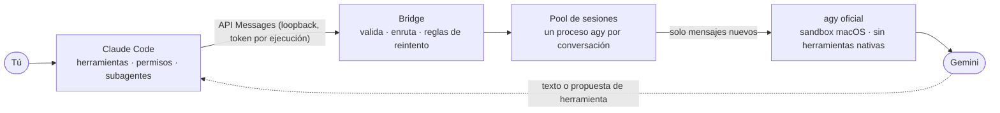

# claudecode-gemini-adapter (español)

**Usa Claude Code con modelos Gemini a través de tu propio login de Antigravity CLI.**
Claude Code sigue ejecutando tus herramientas, permisos, subagentes y comandos; Gemini solo aporta las respuestas del modelo.

[English](README.md) · [Primeros pasos](docs/getting-started.md) · [Configuración](docs/configuration.md) · [Solución de problemas](docs/troubleshooting.md)

> **Proyecto no oficial.** No está afiliado a Anthropic ni a Google. Inicia el programa oficial `agy` (Antigravity CLI) con tu propia cuenta como subproceso detrás de un agente de código. Google distingue entre scripts/CI y usar el CLI con sesión iniciada detrás de otro agente de código ([aclaración](https://discuss.ai.google.dev/t/clarification-on-consumer-plan-policy-for-invoking-official-agy-via-local-subprocess/189905/2)); revisa los términos de tu cuenta antes de usarlo. Solo macOS.

## Cómo funciona



Gemini propone una llamada a herramienta, **Claude Code la ejecuta** y devuelve el resultado en el siguiente turno. Gemini no toca tus archivos ni tu shell: las herramientas nativas de Antigravity están denegadas y el proceso corre dentro de un sandbox de macOS.

## Requisitos

- macOS (usa `/usr/bin/sandbox-exec`).
- Node.js 22 o superior.
- [Claude Code](https://docs.anthropic.com/en/docs/claude-code/overview) instalado (no necesitas cuenta de Anthropic para usarlo con este adaptador).
- [Antigravity CLI (`agy`)](https://antigravity.google/docs/getting-started/) instalado y con sesión iniciada (ejecuta `agy` una vez).

## Instalación

```sh
git clone https://github.com/roanalytics/claudecode-gemini-adapter.git
cd claudecode-gemini-adapter
npm link                 # crea el comando `claude-gemini`
claude-gemini --check    # verifica todo y explica qué falta
claude-gemini            # úsalo
```

Sin `npm link`: `ln -sfn "$PWD/bin/claude-gemini.mjs" ~/.local/bin/claude-gemini`.

## Uso diario

```sh
claude-gemini                              # interactivo (Gemini Neon Low)
claude-gemini --gemini-model fable         # empezar con la ruta de más razonamiento
claude-gemini -p "Explica este repositorio"
```

Cambia de modelo dentro de la sesión con `/model`.

| Rol de Claude | Modelo Gemini | Para qué |
|---|---|---|
| `sonnet` (por defecto) | `gemini-4-neon-low` | Trabajo diario y subagentes |
| `opus` | `gemini-4-neon-high` | Planeación y revisión |
| `fable` | `gemini-4-neon-xhigh` | Problemas difíciles (lento) |
| `haiku` | `gemini-3.8-flash-low` | Tareas rápidas y peticiones de fondo |

## Configuración básica

| Variable | Efecto |
|---|---|
| `CLAUDE_GEMINI_TIMEOUT_S` | Timeout por turno en segundos (600 por defecto) |
| `CLAUDE_GEMINI_MAX_CONCURRENT` | Máximo de peticiones simultáneas por instancia, 1–16 (4 por defecto) |
| `CLAUDE_GEMINI_MAX_SESSIONS` | Máximo de sesiones persistentes de `agy` por instancia (6 por defecto, hasta 32) |
| `CLAUDE_GEMINI_SESSIONS=0` | Desactiva las sesiones persistentes |
| `CLAUDE_GEMINI_LOG=0` | Desactiva el log de peticiones |
| `CLAUDE_GEMINI_MODEL_FABLE` / `OPUS` / `SONNET` / `HAIKU` | Cambia el modelo de un rol |
| `CLAUDE_GEMINI_DENY_READ` | Directorios extra (separados por `:`) que Gemini nunca puede leer |
| `CLAUDE_GEMINI_CLAUDE_BIN` / `CLAUDE_GEMINI_AGY_BIN` | Ruta explícita a Claude Code / Antigravity CLI |

Todas las opciones: [configuration.md](docs/configuration.md). Batería completa de pruebas y regresión: [testing.md](docs/testing.md).

## Problemas comunes

| Síntoma | Qué hacer |
|---|---|
| `claude-gemini --check` muestra `✗` | Lee el texto de esa línea; dice exactamente qué instalar o corregir |
| `AGY_TIMEOUT` | Usa `sonnet` o `haiku`, o sube `--gemini-timeout` |
| `CONTEXT_TOO_LARGE` | Ejecuta `/clear` o abre una sesión nueva |
| Errores en una sesión abierta antes de actualizar | Sal y vuelve a abrir `claude-gemini`: cada sesión conserva el código con el que arrancó |
| Quieres ver qué pasó | `npm run log` (una línea JSON por petición, sin texto de tus prompts) |

Más en [troubleshooting.md](docs/troubleshooting.md) (en inglés). Licencia MIT.
