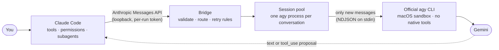

# claudecode-gemini-adapter

**Use Claude Code with Gemini models through your own Antigravity CLI login.**
Claude Code keeps running your tools, permissions, subagents and slash commands. Gemini only supplies the model's answers.

[Español](README.es.md) · [Getting started](docs/getting-started.md) · [Usage](docs/usage.md) · [Configuration](docs/configuration.md) · [Architecture](docs/architecture.md) · [Troubleshooting](docs/troubleshooting.md)

> **Unofficial project.** It is not affiliated with, endorsed by or supported by Anthropic or Google. It starts the official `agy` (Antigravity CLI) program with your own signed-in account, as a subprocess behind a coding agent. Google's published position distinguishes scripts and CI from embedding the signed-in CLI behind another coding agent ([forum clarification](https://discuss.ai.google.dev/t/clarification-on-consumer-plan-policy-for-invoking-official-agy-via-local-subprocess/189905/2)). Read your account's terms and decide for yourself before using it. macOS only.

## What it does



1. `claude-gemini` starts Claude Code against a temporary local Messages endpoint.
2. The bridge turns each request into text for a long-lived, sandboxed `agy` process and turns the answer back into Anthropic-shaped content.
3. Gemini proposes a tool call; **Claude Code executes it** and sends the result on the next turn. Gemini never touches your files, shell or network through Antigravity: its native tools are denied and the process runs inside a macOS sandbox.

## Why use it

- **No API keys and no Anthropic login.** It reuses the Antigravity CLI sign-in you already have.
- **Fast follow-up turns.** After the first turn only new messages are sent: 325–503 characters per turn in a live tool loop instead of about 230 KB, at 2.8–4.1 s per turn on Gemini Neon Medium (see [performance](docs/performance.md)).
- **Token-lean.** A dedicated agent cuts Antigravity's own baseline from 12,929 to 5,097 input tokens per call, and a lean profile drops known memory-plugin noise.
- **Fails once, clearly.** A timeout or invalid answer costs one request with a readable error code, not ten silent retries.
- **Nothing silently truncated.** Antigravity cuts messages above about 192,000 characters without warning; the adapter never sends more than 153,600 and splits large first turns.
- **Safe by construction.** Sandboxed provider, no native tools, no credential access by the adapter ([security](docs/security.md)).
- **Real Claude Code.** Subagents, MCP with Tool Search, skills, hooks, session resume, plan mode and `/model` keep working ([compatibility](docs/claude-code-compatibility.md)).

## Requirements

| Requirement | Notes |
|---|---|
| macOS | Uses `/usr/bin/sandbox-exec` |
| Node.js 22 or newer | Unit tests pass on 22.23 and 26.13 |
| [Claude Code](https://docs.anthropic.com/en/docs/claude-code/overview) | Tested with 2.1.332. No Anthropic account is needed to run it through this adapter |
| [Antigravity CLI (`agy`)](https://antigravity.google/docs/getting-started/) | Tested with 1.5.17, signed in (run `agy` once) |

## Quick start

```sh
# 1. Install Claude Code and the Antigravity CLI (see the links above), then sign in once:
agy

# 2. Install this adapter
git clone https://github.com/roanalytics/claudecode-gemini-adapter.git
cd claudecode-gemini-adapter
npm link            # creates the `claude-gemini` command

# 3. Check everything
claude-gemini --check

# 4. Use it
claude-gemini
```

`claude-gemini --check` prints one line per requirement (`✓` ok, `!` note, `✗` problem) and says exactly what to fix. No `npm link`? Symlink instead: `ln -sfn "$PWD/bin/claude-gemini.mjs" ~/.local/bin/claude-gemini`. Full walkthrough: [getting started](docs/getting-started.md).

## Everyday use

```sh
claude-gemini                                   # interactive, Gemini Neon Low
claude-gemini --gemini-model fable              # start with the top reasoning route
claude-gemini -p "Explain this repository"      # one headless prompt
claude-gemini -p "Reply with OK" --output-format json
```

Everything after the adapter's own flags goes straight to Claude Code. Switch models inside a session with `/model`.

| Claude role | Gemini model | Good for |
|---|---|---|
| `sonnet` (default) | `gemini-4-neon-low` | Everyday coding and subagents |
| `opus` | `gemini-4-neon-high` | Planning and review |
| `fable` | `gemini-4-neon-xhigh` | Hardest problems (slow: tens of seconds per turn) |
| `haiku` | `gemini-3.8-flash-low` | Quick, narrow tasks and background requests |

Any route can be replaced with `CLAUDE_GEMINI_MODEL_<ROLE>`; see [configuration](docs/configuration.md).

## Documentation

| Guide | What is inside |
|---|---|
| [Getting started](docs/getting-started.md) | Step-by-step install, verification, uninstall |
| [Usage](docs/usage.md) | Interactive and headless use, subagents, MCP, sessions, tips |
| [Configuration](docs/configuration.md) | Flags, environment variables, lean filters, log format |
| [Architecture](docs/architecture.md) | Components, diagrams, session lifecycle, error handling |
| [Security](docs/security.md) | Threat model, sandbox, what is logged |
| [Performance](docs/performance.md) | Measurements and how to reproduce them |
| [Claude Code compatibility](docs/claude-code-compatibility.md) | Feature matrix from the live feature canary |
| [Testing & regression](docs/testing.md) | Replicable unit, smoke, 29-feature and parallel stress suites |
| [Troubleshooting](docs/troubleshooting.md) | Every error code and what to do |
| [Research notes](docs/research/findings.md) | How the approach was validated |
| [Contributing](CONTRIBUTING.md) · [Security policy](SECURITY.md) · [Changelog](CHANGELOG.md) | |

## FAQ

**Does it need an Anthropic account or API key?** No. Claude Code runs against a local endpoint; the adapter never sends traffic to Anthropic's API.

**Does Gemini see my files?** Only what Claude Code puts into the conversation (file contents it reads, command output). Antigravity's own file, shell, web and MCP tools are disabled and sandboxed.

**Why macOS only?** Isolation relies on `sandbox-exec`. Other platforms are not supported.

**Can images and PDFs be used?** Claude Code can read them, but this route does not forward them to Gemini; the model sees a placeholder and says so.

**An old session shows errors after I upgraded.** A running session keeps the code it started with. Exit and start `claude-gemini` again.

## License

MIT. See [LICENSE](LICENSE).
