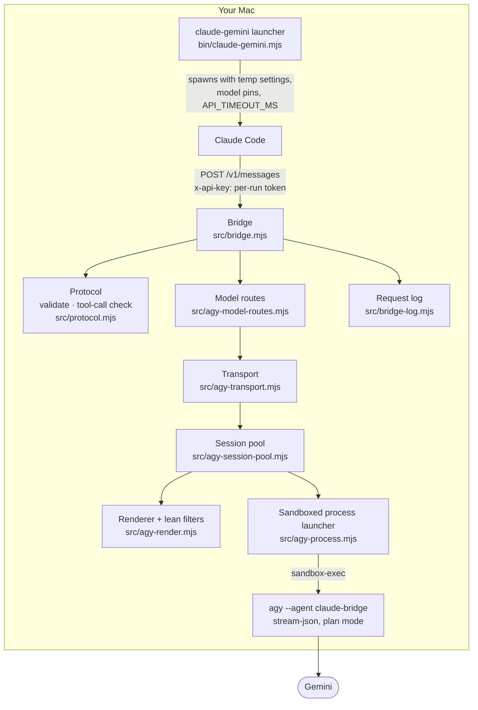
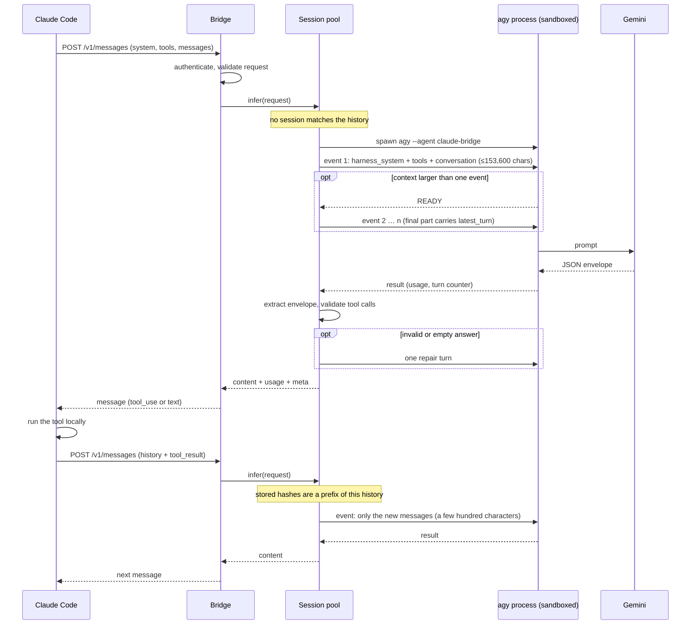
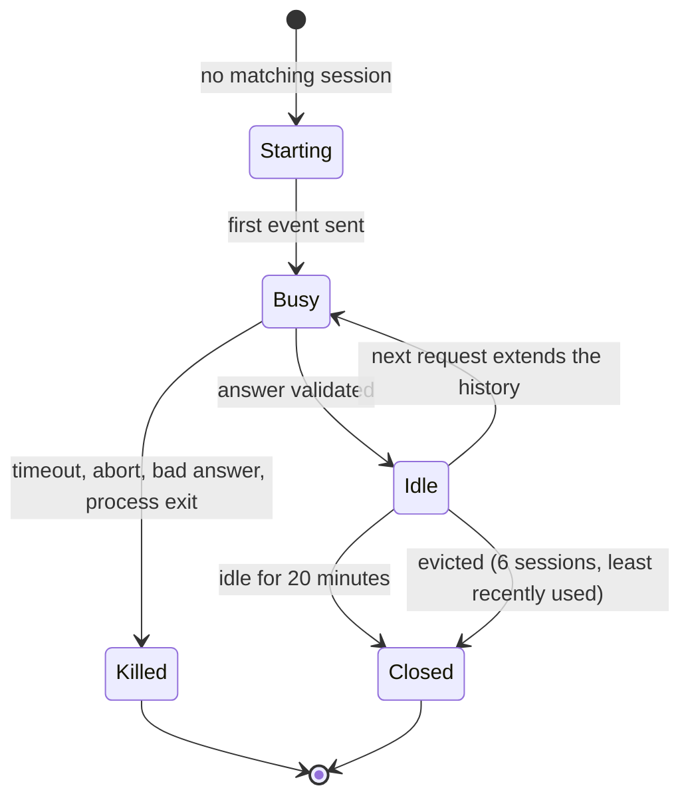
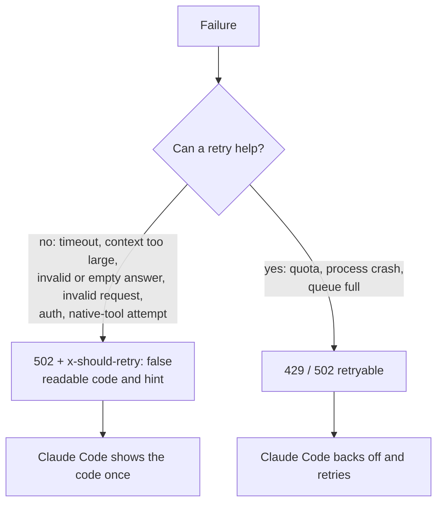

# Architecture

This document explains how a Claude Code request becomes a Gemini answer, how conversations stay cheap, and how failures are reported.

## Components



| File | Responsibility |
|---|---|
| `bin/claude-gemini.mjs` | Launcher and doctor (`--check`): argument parsing, binary discovery, readable startup errors |
| `src/harness.mjs` | Starts Claude Code with a temporary settings file, model-role pins, a per-run capability and the loopback bridge |
| `src/bridge.mjs` | Authenticated local Messages endpoint: admission, queue, error mapping (`x-should-retry`), `count_tokens`, request log |
| `src/protocol.mjs` | Validates Messages requests and tool schemas; validates the model's tool calls; builds Messages responses and SSE |
| `src/agy-model-routes.mjs` | Exact role-to-model routing and overrides; no fallback |
| `src/agy-transport.mjs` | Decodes and validates `agy` turn events; classifies failures; stateless fallback path |
| `src/agy-session-pool.mjs` | Persistent `agy` processes: prefix matching, delta events, split first turns, repair turns, eviction |
| `src/agy-render.mjs` | Renders conversations as tagged text, lean-profile filters, message hashes, event splitting, token estimate |
| `src/agy-envelope.mjs` | Tolerant extraction of the JSON answer from Gemini's text |
| `src/agy-agent.mjs` | The `claude-bridge` agent definition (no tools, MCP, skills or plugins) and the `agy` arguments |
| `src/agy-process.mjs` | macOS sandbox profile, environment, process launch, filtered stderr |
| `src/agy-profile.mjs` | Reads Antigravity settings (never credentials): errors vs. warnings |
| `src/binaries.mjs` | Locates `claude` and `agy` |
| `src/agy-limits.mjs` | The measured truncation limit and the safe event size |
| `src/bridge-log.mjs` | Rotating JSON-lines log without prompt text |
| `config/lean-filters.json` | Default lean-profile rules |

## One turn, from request to answer

First turn of a conversation, then a follow-up:



### Rendering

Each message is rendered as plain tagged text rather than a nested JSON string:

```text
<harness_system> … </harness_system>
<tools> <tool name="Read"> description + input_schema </tool> … </tools>
<conversation>
  <message role="user"> … </message>
  <message role="assistant"> <tool_use id=… name=…>{…}</tool_use> </message>
  <message role="user"> <tool_result id=… error="false"> … </tool_result> </message>
</conversation>
<latest_turn>Respond … with the JSON envelope only.</latest_turn>
```

Deferred tools (Claude's Tool Search) appear as `<tool name="…" deferred="true"/>` until a `tool_reference` loads them. Images and documents become explicit placeholders. A dedicated Antigravity agent (`claude-bridge`) explains this format once, so it does not have to be repeated in every message.

### Session matching

Every message gets a canonical hash (text, tool-use ids and names, tool-result ids and content digests; tool inputs and cache hints are ignored on purpose because Claude may rewrite them). A session is reused when its stored hashes are a strict prefix of the new request, the system prompt and model match, and the next message is not an assistant message. Otherwise a new session is started. Compaction or editing of history therefore causes a clean restart rather than a stale context.

### Split first turns

Antigravity silently truncates one message at about 192,000 characters, losing the newest content. Events are capped at 153,600 characters. A larger first turn is sent as numbered parts; each part except the last asks the model to reply `READY`.

### Answer handling

1. The JSON envelope is extracted tolerantly: fenced, surrounded by prose, duplicated, or in common tool-call shapes (`{name, arguments}`).
2. If the answer is clearly an envelope but is not valid JSON, a lenient reader repairs the usual mistakes: unescaped double quotes and raw newlines inside strings (typically code passed to `Edit` or `Write`), invalid escapes such as `\'` and `\$`, and trailing commas. A double quote inside a string only ends it when what follows is plausible for the current container, so `obj["key"]` inside code survives. A broken envelope is **never shown to you as text**.
3. Each `tool_use` is checked against the schema Claude offered; unknown tools or invalid inputs are rejected.
4. An invalid, unparseable or empty answer gets **one** repair turn in the same session (for malformed JSON the model is told where the parser failed). A second failure is final (`INVALID_MODEL_JSON`, `INVALID_MODEL_TOOL_CALL`, `AGY_EMPTY_RESULT`).
5. Only validated answers are committed to the session history.
6. Token usage is reported per request: Antigravity counts output and cache-read tokens as running totals for the session, so the pool reports the difference between consecutive turns.

## Session lifecycle



A reused session that fails is replaced once by a fresh session before the error is reported. Aborting a request in Claude Code kills the session process so it stops generating.

## Error handling

Claude Code retries most failures, and it **ignores** the `x-should-retry` header for 4xx responses (measured):

| Status returned to Claude Code | Requests Claude Code made |
|---|---|
| 400 | 4 |
| 401, 403 | 9 |
| 404 | 2 |
| 422 | 4 |
| 413, 501 | 1 |
| 502 with `x-should-retry: false` | 1 |

So failures that cannot succeed on retry are returned as **502 with `x-should-retry: false`**; transient ones stay retryable.



Late errors are never sent as SSE events after the stream starts, because Claude Code retries those too. The SSE keepalive (`pingMs`) therefore exists but is off by default.

## Request validation

The bridge is strict about structure and tolerant about novelty, so a newer Claude Code or an unfamiliar MCP server does not take a session down.

| Input | Handling |
|---|---|
| Unknown top-level request fields (for example `safeguards`, `context_management`) | Dropped; their **names** (never values) are recorded as `meta.ignoredFields` in the log |
| Unknown content block types | Accepted; rendered as `[<type> block omitted]` |
| Images and documents (messages or tool results) | Accepted; rendered as an explicit placeholder, never as bytes |
| Server tools such as web search (a tool with a `type` and no schema) | Removed from the tool list, recorded as `meta.ignoredTools`; the model cannot use them here (use WebFetch) |
| JSON Schema keywords the matcher does not know (`if`/`then`, `dependentRequired`, `nullable`, `x-*` ...) | Ignored; supported keywords (`type`, `required`, `enum`, `const`, `pattern`, bounds, `anyOf`/`oneOf`/`allOf`/`not`, `min/maxProperties` ...) are enforced on the model's tool calls |
| Any number of tools | Accepted (up to 2000) |
| Roles outside `user`/`assistant`/`system`, unpaired `tool_use`/`tool_result`, invalid tool names or schemas, `thinking` enabled, non-empty `stop_sequences`, invalid sampling values | Rejected once with a non-retryable 502 and a stable code |

## Why not `agy acp` or `--json-schema`?

- `--json-schema` makes Antigravity run four internal turns per message, duplicates the answer, and was 3–7× slower with 3–5× more tokens ([performance](performance.md)).
- A stream-json session already gives persistent multi-turn state with `num_turns` and cache reads, so the Agent Client Protocol was not needed for this design.
